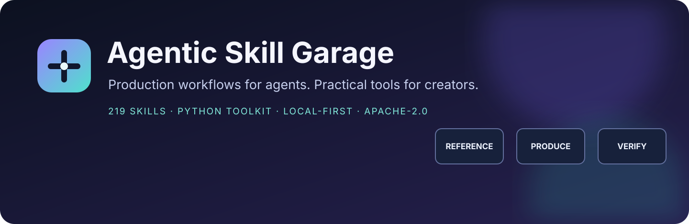
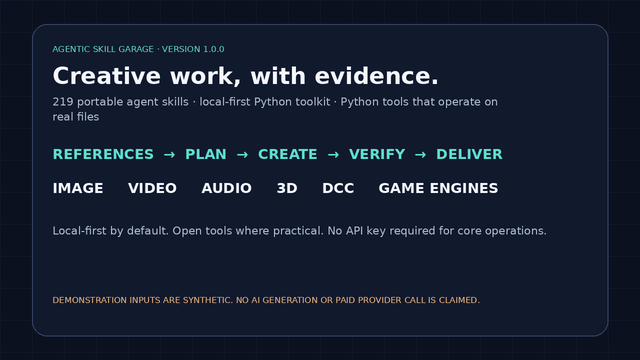
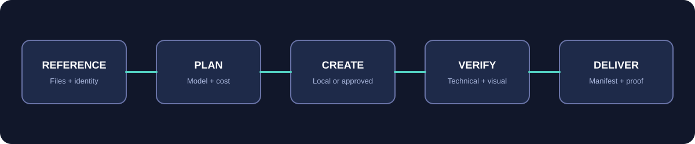

<div align="center">



# Agentic Skill Garage

### Production workflows for agents. Practical tools for creators.

**219 portable agent skills + a local-first Python toolkit** for image, video, audio, 3D, asset management, generative workflows, and creative delivery.

<a href="https://github.com/voyager67/agentic-skill-garage/stargazers"></a>
<a href="https://github.com/voyager67/agentic-skill-garage/network/members"></a>
<a href="LICENSE"></a>
<a href="https://github.com/voyager67/agentic-skill-garage/actions/workflows/ci.yml"></a>
<a href="https://skills.sh/voyager67/agentic-skill-garage"></a>
<a href="https://www.python.org/"></a>
<a href="skills-index.json"></a>

</div>

---

## See the Garage in action

[](assets/agentic-skill-garage-demo.mp4)

<p align="center"><a href="assets/agentic-skill-garage-demo.mp4">▶ Watch the full CLI walkthrough (MP4)</a> · <a href="https://voyager67.github.io/agentic-skill-garage/">Open the project showcase</a></p>



## One library. End-to-end creative workflows.

Agentic Skill Garage equips compatible AI agents with focused, reusable procedures and gives them practical local tools for moving, inspecting, preparing, and validating creative assets. It is designed to connect the work around creative applications, not to lock users into one model provider.

| Capability | What it covers |
|---|---|
| **Image production** | Reference-led generation and editing, restoration, compositing, resizing, sprite sheets, contact sheets, and export checks. |
| **Video production** | Storyboards, shot planning, continuity, rough cuts, audio sync, color workflows, and delivery validation. |
| **Audio production** | Dialogue cleanup, sound design, localization, loudness, true-peak control, and mastering preflight. |
| **3D and digital content** | Modeling, sculpting, topology, UVs, materials, rigging, baking, and interchange formats. |
| **DCC and game engines** | Specialist workflows for Blender, Maya, ZBrush, Unreal Engine, Unity, and Godot. |
| **Agentic model operations** | Local ComfyUI, Scenario MCP discovery, reference lineage, model selection, job monitoring, and cost gates. |
| **Asset operations** | File intake, SHA-256 manifests, duplicate detection, identity profiles, and handoff-ready reference packets. |
| **Engineering and research** | Repository analysis, testing, debugging, security review, dataset quality, experiments, and evaluation design. |

## Practical Python tools

The `asg` CLI performs real local operations; skills provide the procedures agents use to plan and connect those operations.

```bash
python -m venv .venv
# Windows: .venv\Scripts\activate
# macOS/Linux: source .venv/bin/activate
pip install -e ".[images]"
asg doctor
```

```bash
# Build a traceable local reference library
asg assets ingest ./references --recursive --library ./asg-assets
asg assets list --library ./asg-assets

# Keep character, product, or brand requirements with their reference set
asg identity init "Nova" --kind character --output ./identity/nova.json
asg identity prompt ./identity/nova.json --manifest ./asg-assets/manifest.jsonl

# Inspect, process, and verify media
asg image info ./references/hero.png
asg image resize ./references/hero.png ./exports/hero.webp --width 1600 --height 900 --fit contain
asg image contact-sheet ./references/one.png ./references/two.png --output ./exports/contact.jpg
asg media probe ./input.mov
asg media loudness ./input.mov
asg media normalize-audio ./input.mov ./exports/normalized.wav --target-lufs -16
asg media transcode ./input.mov ./exports/web.mp4 --preset h264-web

# Connect explicitly to a local ComfyUI instance
asg comfyui status
asg comfyui upload ./references/hero.png
asg comfyui submit ./workflow-api.json
asg comfyui wait <prompt-id> --timeout 600

# Inspect or render a Blender scene when Blender is installed
asg blender audit ./scene.blend
asg blender render ./scene.blend ./renders/preview --frame 1
```

The core package uses Python's standard library. Pillow enables optional image commands. FFmpeg/FFprobe, Blender, ComfyUI, and the named DCC/game-engine applications are optional prerequisites for their respective operations.

## Browse the skill library

The catalogue contains **219 independently authored `SKILL.md` workflows**, organized by production domain. Start with the [machine-readable skill index](skills-index.json) or browse the [`skills/`](skills/) directory.

Install the complete skill library with the open `skills` CLI (Node.js 22.20+):

```bash
# Disable the installer's own anonymous telemetry for this command
DISABLE_TELEMETRY=1 npx skills add voyager67/agentic-skill-garage --all
```

On PowerShell, set `$env:DISABLE_TELEMETRY = "1"` before running the same `npx` command. The external installer has its own telemetry controls; this setting is separate from Agentic Skill Garage, which includes no telemetry. See the [skills CLI reference](https://www.skills.sh/docs/cli). Skill files are plain Markdown with standard frontmatter; no vendor runtime is bundled.

## Designed for control, not hidden spend

- **Local-first:** asset intake, hashing, identity profiles, image helpers, and media processing run on your machine.
- **Explicit transfers:** network destinations and reference uploads are opt-in; ComfyUI defaults to loopback.
- **Cost before generation:** estimates use dated, sourced rate cards. Missing or stale rates are reported as unpriced.
- **No telemetry:** no analytics, background uploads, or automatic provider calls are included.
- **No silent overwrites:** file operations use explicit destinations and guarded output behavior.
- **Privacy-aware:** read [PRIVACY.md](PRIVACY.md) and [SECURITY.md](SECURITY.md) before connecting external services.

## Evidence and scope

The demo uses synthetic inputs and shows actual local CLI operations. Automated tests cover filesystem safety, reference intake, identity packets, quote validation, ComfyUI request policy, image helpers, and media handling. Application-specific Maya, ZBrush, Unreal, Unity, Godot, Blender, Scenario MCP, and live ComfyUI behavior must be tested on systems where those applications or services are installed and configured.

**This project does not claim to recreate a hosted image/video model or replace a proprietary editor by installing a skill.** It orchestrates local open tools and explicitly connected services, with application-specific workflows where supported.

## Contributing

Contributions should add a concrete workflow, executable helper, compatibility test, or reproducible improvement. Read [CONTRIBUTING.md](CONTRIBUTING.md) before submitting changes.

## License

Agentic Skill Garage is released under the [Apache License 2.0](LICENSE). Third-party applications, models, extensions, and services retain their own licenses and terms. See [NOTICE.md](NOTICE.md) and [REFERENCES.md](REFERENCES.md).

---

<div align="center">

**Agentic Skill Garage** · Open workflows. Real tools. Verifiable output.

</div>
